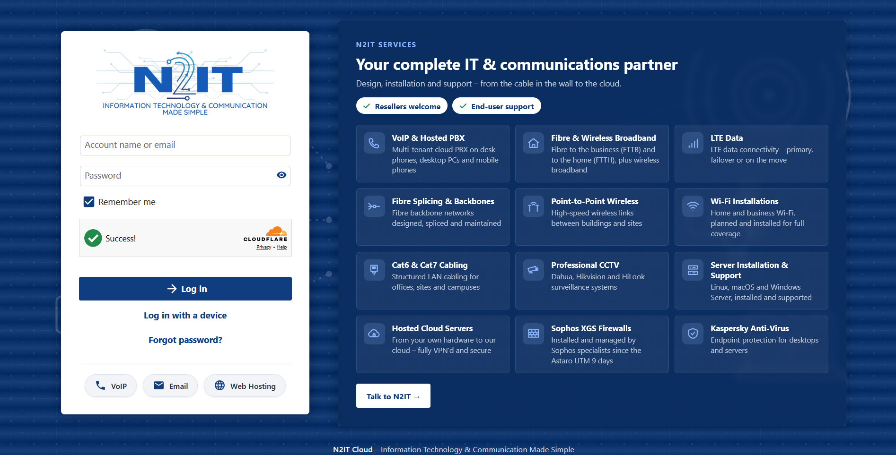

# N2IT login kit

Shared branding for the N2IT sign-in pages: **cloud.nextel.co.za / cloud.n2it.co.za** (Nextcloud), **voip.n2it.co.za** (FusionPBX), **unifi.n2it.co.za** (UniFi OS), the **N2IT hosting panel** (cpl-jhb.n2it.co.za/my) and **webmail** (cpanel.nextel.co.za/webmail). The Webuzo panel (cpl-jhb.nextel.co.za:2083/2087/2096) was retired on 25 Oct 2026; `:2096` now redirects to the new webmail.

The main piece is the **services panel**: 12 N2IT services, "Resellers welcome" / "End-user support" badges and a "Talk to N2IT" button. It's live on the Nextcloud login page and should look the same everywhere.



## What's here

| Path | What it is |
|---|---|
| `panel/n2it-services.js` | Standalone panel builder. Exposes `N2ITServices.mount(ref, where)`. **Edit the services list here.** |
| `panel/n2it-services.css` | Standalone panel styles (navy glass panel, tiles, badges, phone layout). |
| `panel/n2it-skyline.css` | **The 2026-10 sign-in look** (skyline background, mono label, 12px card with blue top edge, navy button). Drop-in classes plus a ready block for FusionPBX. |
| `assets/` | N2IT logo, favicon, **`n2it-login-skyline.svg`** (current background) and `inter.woff2` (the font); `n2it-login-art.svg`, `n2it-login-pattern.svg`, `n2it-background.jpg` are the pre-October look, kept for sites not yet moved. |
| `nextcloud/n2itlogin/` | The Nextcloud app running on cloud.nextel.co.za. It's the reference implementation: card, Turnstile, pills and services panel. 1.1.0 = skyline look. |

## Brand (2026-10 "skyline" look)

This is what the hosting panel and webmail show today; voip, cloud and unifi should match it.

- **Background:** `#030c1f` with `assets/n2it-login-skyline.svg` anchored bottom-right (`right bottom / cover no-repeat fixed`), under two gradients: `linear-gradient(0deg, rgba(3,12,31,.85) 0%, rgba(3,12,31,0) 30%)` and a flat `rgba(3,12,31,.25)` haze. The full stack is in `panel/n2it-skyline.css`.
- **Font:** Inter (`assets/inter.woff2`, variable 100-900), system-ui fallback. Mono label above the card: `500 11px ui-monospace`, letter-spacing `.14em`, uppercase, `#9cc6ff`, text `N2IT / <Site> sign-in` (panel: "Secure", webmail: "Webmail", cloud: "Cloud", voip: "VoIP").
- **Card:** white, 420px (`min(420px, 100vw - 32px)`), `padding: 28px`, `border-radius: 12px`, `border-top: 3px solid #145ab6`, shadow `0 20px 25px -5px rgba(0,0,0,.35), 0 8px 10px -6px rgba(0,0,0,.25)`. Colour logo inside, **56px high**, centred, 20px below it.
- **Fields:** labels above the inputs, `#061a3a` 600; inputs white, `border: 1px solid #c8d3e2`, `border-radius: 8px`, `min-height: 44px`; focus ring `0 0 0 3px rgba(20,90,182,.18)`.
- **Button:** full width, "Sign in", `#061a3a`, hover/focus `#145ab6`, `border-radius: 8px`, `padding: 12px`. Links `#145ab6`.
- **Pills under the form:** VoIP (voip.n2it.co.za), Email (cpanel.nextel.co.za/webmail), Web Hosting (www.n2it.co.za); `border-radius: 8px` in this look.
- Cloudflare Turnstile sitekey `0x4AAAAAAFSLraJVe15YiVwR`, pre-clearance mode. Every hostname that shows the widget must be on the widget's hostname list in the Cloudflare dashboard, or it fails with error 110200.

Older palette, still used by the services panel: navy `#0f3d80`, hover `#145ab6`, gradient `#0f3d80 → #0a2a5a`, light accent `#8db8ff`.

## Applying the skyline look to a site

1. Copy `panel/n2it-skyline.css`, `assets/n2it-login-skyline.svg` and `assets/inter.woff2` next to the site's existing N2IT branding files (same folder, the CSS uses relative URLs) and load the CSS **after** the site's own branding CSS, with a `?v=` query.
2. Add class `n2it-skyline` to `<body>`, `n2it-skyline-card` to the login card, `n2it-skyline-logo` to the logo image and an element with `n2it-skyline-label` (text `N2IT / <Site> sign-in`) just before the card. If classes can't be added, extend the selectors in the CSS with the site's own, like the FusionPBX block does.
3. Check the card at desktop, laptop (~1280px) and phone (~400px) widths, with Turnstile still passing, and that the skyline is visible bottom-right (it needs `background-attachment: fixed`, which Safari on iOS ignores: there it scrolls with the page, which is fine).
4. Bump the cache-busting version; on Nextcloud bump `appinfo/info.xml` and re-run `install-app.sh`.

## Adding the panel to a site

1. Copy `panel/n2it-services.js` and `panel/n2it-services.css` next to the site's existing N2IT branding files and load them on the login page (after the site's own CSS).
2. Once the login card exists, call:
   ```js
   var panel = N2ITServices.mount(cardOrItsContainer, 'after');
   ```
3. Lay the card and panel out like the Nextcloud page:
   - **≥ 1100px wide:** side by side, card 420px, 48px gap, panel `flex: 0 1 620px; min-width: 520px`. Add class `n2it-svc-wide` to the panel at this size.
   - **≥ 1500px:** the CSS widens a `.n2it-svc-wide` panel to 860px with 3 columns, so the 15 services fit in 5 rows (tiles are a little tighter there so the panel still fits a 1080p screen).
   - **Narrower:** the panel stacks under the card at the card's width (default CSS). On phones it shows titles only.

   The usual way: turn the common parent of card and panel into a wrapping flex row, and give the footer `flex-basis: 100%`. See `#body-login.n2it-ads` in `nextcloud/n2itlogin/css/n2it-login.css`.
4. Test at desktop, laptop (~1280px) and phone (~400px) widths, with Turnstile still passing.

### Site notes

- **voip.n2it.co.za (FusionPBX):** `#default_login` is `position: fixed` and centred with `transform`. Switch it to normal flow (or wrap it) before placing the panel beside it, and keep the phone-app pills (`#n2it_app_links`) under the card. The Turnstile widget is already in the form. **Skyline:** the last block of `panel/n2it-skyline.css` already targets `body.n2it-skyline #default_login` (card, label "N2IT / VoIP sign-in", inputs, button) - add class `n2it-skyline` to `<body>` in the login template, load the CSS and copy the svg + woff2 next to it. Check the logo `` inside `#default_login` ends up 56px high; if FusionPBX wraps it differently, adjust that one selector.
- **unifi.n2it.co.za (UniFi OS):** the existing `n2it-unifi.js` tags the card `.n2it-card` (fixed and centred) and re-applies on every React render with a MutationObserver. Mount the panel from that same `apply()` loop, and change `.n2it-card` from fixed centring to a flex layout that also holds the panel. Never move React-owned nodes; only add your own. Installed by `/root/unifi-branding/apply.sh` on that server.
- **N2IT hosting panel + webmail (npanel):** built in; the panel is the reference for the skyline look (`app/npanel/static/panel.css`, sign-in section, and `deploy/webmail/n2it_branding/` in the Npanel repo). The Roundcube copy in `../branding/webuzo/roundcube-plugin/` is kept in sync with it.
- **Webuzo (retired 25 Oct 2026):** notes kept in `../branding/README.md`.

### Caching

Cloudflare caches JS/CSS. Give the files a version query string (`n2it-services.js?v=2`) and bump it on every edit, or visitors keep the old copy. On Nextcloud the app version in `appinfo/info.xml` does this (1.1.0 = skyline). If a server has pulled but still shows the old look, purge the file in the Cloudflare cache and reload without cache.

## Keeping sites in sync

The services list lives in `panel/n2it-services.js` (`SERVICES_HEAD`, `SERVICES`). Change it there, commit, then pull on each server and re-run that server's branding script. The Nextcloud app has its own copy in `nextcloud/n2itlogin/js/n2it-login.js`; update both.

## For a Claude Code session on another server

> Pull this repo. Add the N2IT services panel to this server's login page using `panel/n2it-services.js` and `panel/n2it-services.css`, matching the layout described in README.md and the reference Nextcloud implementation. Hook it into this server's existing N2IT branding script so it survives updates. Test desktop, laptop and phone widths and confirm Cloudflare Turnstile still passes. Bump cache-busting versions.
