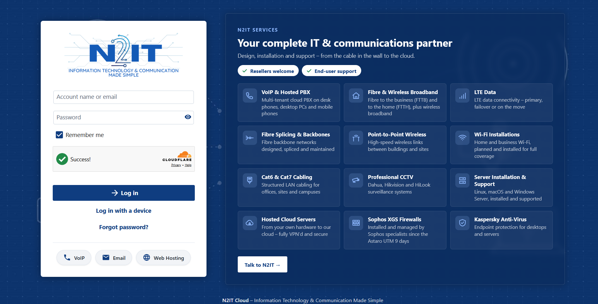

# N2IT login kit

Shared branding for the N2IT sign-in pages: **cloud.nextel.co.za / cloud.n2it.co.za** (Nextcloud), **voip.n2it.co.za** (FusionPBX), **unifi.n2it.co.za** (UniFi OS) and the **Webuzo** panel (cpl-jhb.nextel.co.za).

The main piece is the **services panel**: 12 N2IT services, "Resellers welcome" / "End-user support" badges and a "Talk to N2IT" button. It's live on the Nextcloud login page and should look the same everywhere.



## What's here

| Path | What it is |
|---|---|
| `panel/n2it-services.js` | Standalone panel builder. Exposes `N2ITServices.mount(ref, where)`. **Edit the services list here.** |
| `panel/n2it-services.css` | Standalone panel styles (navy glass panel, tiles, badges, phone layout). |
| `assets/` | N2IT logo, favicon, login background (`n2it-login-art.svg`, `n2it-login-pattern.svg`, pre-rendered `n2it-background.jpg`). |
| `nextcloud/n2itlogin/` | The Nextcloud app running on cloud.nextel.co.za. It's the reference implementation: card, Turnstile, pills and services panel. |

## Brand

- Navy `#0f3d80`, hover `#145ab6`, gradient `#0f3d80 → #0a2a5a`, light accent `#8db8ff`.
- White login card: `border-radius: 6px`, `padding: 30px`, `box-shadow: 0 1px 20px rgba(0,0,0,.35)`, colour logo 300px wide inside.
- Pills under the form: VoIP (voip.n2it.co.za), Email (cpl-jhb.nextel.co.za:2096), Web Hosting (www.n2it.co.za).
- Cloudflare Turnstile sitekey `0x4AAAAAAFSLraJVe15YiVwR`, pre-clearance mode. Every hostname that shows the widget must be on the widget's hostname list in the Cloudflare dashboard, or it fails with error 110200.

## Adding the panel to a site

1. Copy `panel/n2it-services.js` and `panel/n2it-services.css` next to the site's existing N2IT branding files and load them on the login page (after the site's own CSS).
2. Once the login card exists, call:
   ```js
   var panel = N2ITServices.mount(cardOrItsContainer, 'after');
   ```
3. Lay the card and panel out like the Nextcloud page:
   - **≥ 1100px wide:** side by side, card 420px, 48px gap, panel `flex: 0 1 620px; min-width: 520px`. Add class `n2it-svc-wide` to the panel at this size.
   - **≥ 1500px:** the CSS widens a `.n2it-svc-wide` panel to 860px with 3 columns, so the 12 services fit in 4 rows.
   - **Narrower:** the panel stacks under the card at the card's width (default CSS). On phones it shows titles only.

   The usual way: turn the common parent of card and panel into a wrapping flex row, and give the footer `flex-basis: 100%`. See `#body-login.n2it-ads` in `nextcloud/n2itlogin/css/n2it-login.css`.
4. Test at desktop, laptop (~1280px) and phone (~400px) widths, with Turnstile still passing.

### Site notes

- **voip.n2it.co.za (FusionPBX):** `#default_login` is `position: fixed` and centred with `transform`. Switch it to normal flow (or wrap it) before placing the panel beside it, and keep the phone-app pills (`#n2it_app_links`) under the card. The Turnstile widget is already in the form.
- **unifi.n2it.co.za (UniFi OS):** the existing `n2it-unifi.js` tags the card `.n2it-card` (fixed and centred) and re-applies on every React render with a MutationObserver. Mount the panel from that same `apply()` loop, and change `.n2it-card` from fixed centring to a flex layout that also holds the panel. Never move React-owned nodes; only add your own. Installed by `/root/unifi-branding/apply.sh` on that server.
- **Webuzo (cpl-jhb.nextel.co.za:2083/2087):** the logo row and form row (`.login-form.bg-transparent` + `.login-form`) together make the card. Mount after the form row's container. Installed by `/root/webuzo-branding/apply.sh` on that server.

### Caching

Cloudflare caches JS/CSS. Give the files a version query string (`n2it-services.js?v=2`) and bump it on every edit, or visitors keep the old copy. On Nextcloud, `install-app.sh` bumps the app version for the same reason.

## Keeping sites in sync

The services list lives in `panel/n2it-services.js` (`SERVICES_HEAD`, `SERVICES`). Change it there, commit, then pull on each server and re-run that server's branding script. The Nextcloud app has its own copy in `nextcloud/n2itlogin/js/n2it-login.js`; update both.

## For a Claude Code session on another server

> Pull this repo. Add the N2IT services panel to this server's login page using `panel/n2it-services.js` and `panel/n2it-services.css`, matching the layout described in README.md and the reference Nextcloud implementation. Hook it into this server's existing N2IT branding script so it survives updates. Test desktop, laptop and phone widths and confirm Cloudflare Turnstile still passes. Bump cache-busting versions.
